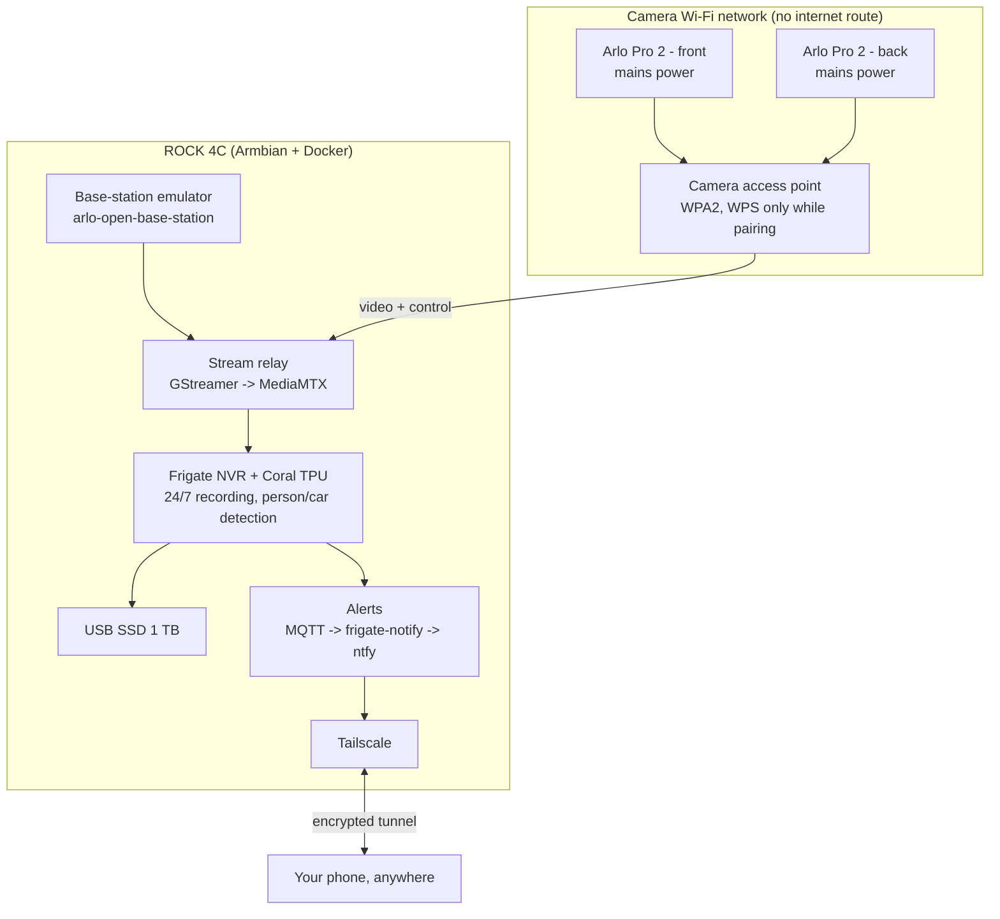

# arlo-pro2-local-nvr

Keep using end-of-life **Arlo Pro 2** cameras with no cloud and no subscription. They become fully local cameras, with 24/7 recording and AI person and vehicle detection running on a small single-board computer.

> **Status: planning / design.** The spec and implementation plan are written. Configs and scripts will be added as each phase is built and tested.

## Why

Arlo ended support for the Pro 2 (VMC4030P) on 1 January 2025. Security patches ended around January 2026. The cameras still work as hardware, but:

- their firmware will never be patched again, and the base station keeps a permanent link to Arlo's cloud
- useful features sit behind a paid subscription
- the cameras have no official local video stream (RTSP)

No custom firmware exists for the Pro 2, and this project doesn't try to make one. It **replaces the Arlo base station** instead. The cameras pair with a computer you control, on a Wi-Fi network that has no route to the internet.

## How it works

| Layer | Component |
| --- | --- |
| Base-station emulator | [arlo-open-base-station](https://github.com/frandallfarmer/arlo-open-base-station), built on [arlo-cam-api](https://github.com/Meatballs1/arlo-cam-api) |
| Stream relay | GStreamer + [MediaMTX](https://github.com/bluenviron/mediamtx). FFmpeg drops Arlo streams after about 6 seconds |
| Recorder and detection | [Frigate](https://frigate.video) + Google Coral USB Edge TPU |
| Alerts | Mosquitto, frigate-notify, [ntfy](https://ntfy.sh) |
| Remote access | [Tailscale](https://tailscale.com), no open ports |
| Isolation | nftables: the camera network can reach only the host |

## Hardware

- 2 × Arlo Pro 2 (VMC4030P), wired to mains power
- Radxa ROCK 4C / 4C+ (RK3399 family). Any arm64 or x86 Linux box with USB 3 should work
- Google Coral USB Accelerator
- 1 TB USB 3 SSD
- A Wi-Fi access point with WPS (e.g. TP-Link Omada EAP225), or a USB Wi-Fi adapter that supports AP mode

## Documents

- [docs/SPEC.md](docs/SPEC.md): the full spec covering the problem, research, requirements, architecture, security design, risks and legal notes
- [docs/IMPLEMENTATION_PLAN.md](docs/IMPLEMENTATION_PLAN.md): step-by-step phases with acceptance gates and the test plan

## What this repo will never contain

- Arlo firmware, update packages or firmware dumps
- Keys, passwords or other material extracted from Arlo devices
- Copies of upstream code that has no licence (it is linked or fetched instead)
- Anyone's Wi-Fi keys, tokens, camera serials or footage

## Credits

This builds on the reverse-engineering work of the [arlo-cam-api](https://github.com/Meatballs1/arlo-cam-api) authors and forks, and on [arlo-open-base-station](https://github.com/frandallfarmer/arlo-open-base-station).

## Disclaimer

Not affiliated with or endorsed by Arlo Technologies, Inc. "Arlo" and "Arlo Pro" are trademarks of Arlo Technologies, Inc. and are used here only to describe compatibility.

This is an interoperability and home-security project for hardware you own. Check your local surveillance and privacy laws before recording, especially audio. Use it at your own risk.

## License

[MIT](LICENSE)
