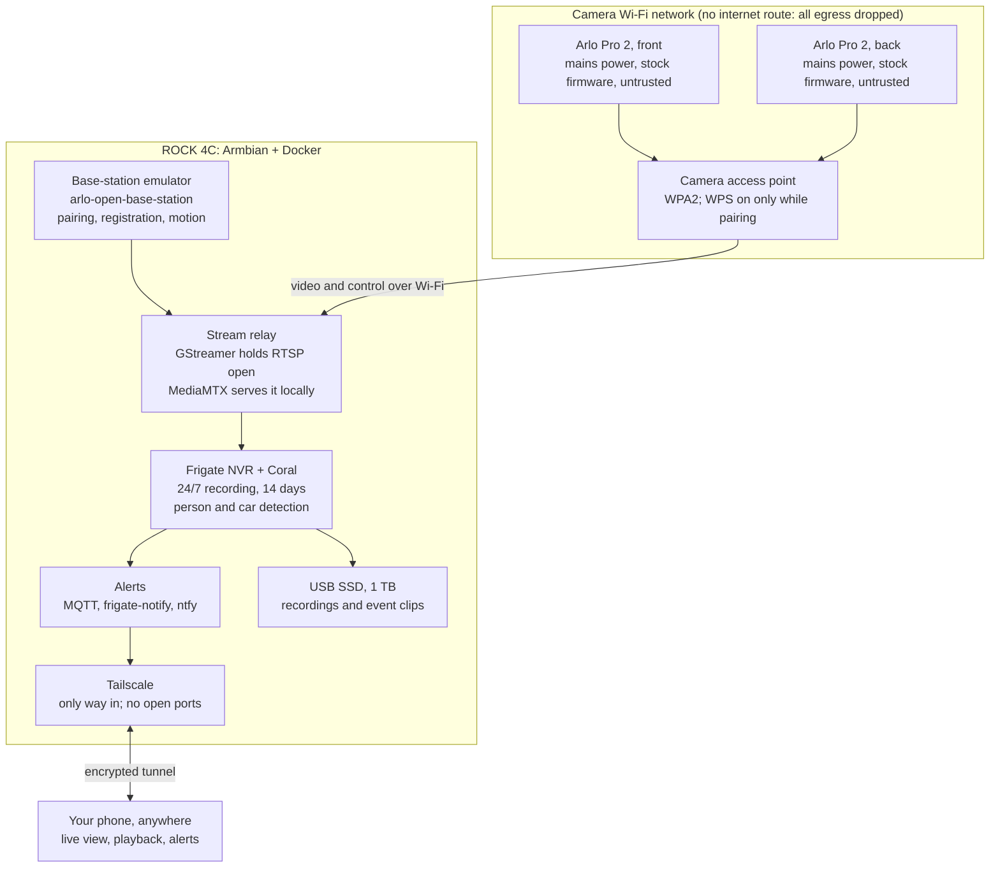

# Arlo Pro 2 Local Base Station — Spec

*As of 17 October 2026*

## Summary

**Decision: keep the two mains-powered Arlo Pro 2 cameras and replace the Arlo base station and cloud with a self-hosted base station on the ROCK 4C. Do not attempt to modify the camera firmware.**

No custom firmware exists for the Arlo Pro 2. Building one would be a multi-month research project with a high chance of bricking the cameras. The camera firmware does not need to change anyway: the cameras trust whatever Wi-Fi network and base station they are paired to, and open-source projects already emulate that base station.

The plan: the ROCK 4C runs a camera-only Wi-Fi network with no internet route. It pairs the cameras and pulls their video locally. A stream relay keeps those feeds stable, and Frigate records 24/7 with the Coral Edge TPU doing person and vehicle detection. Alerts go to the phone through self-hosted ntfy. Remote viewing goes over Tailscale or WireGuard. Recurring cost: $0. One-off cost: about A$150–250 for an SSD and a Wi-Fi access point.

Publishing a public repo is low risk if it holds only original code and docs. It must not include Arlo firmware, keys, credentials or copied Arlo code. See [Legal](#legal-running-it-and-publishing-a-public-repo).

## Problem statement

Two Arlo Pro 2 cameras still work as hardware, but the software around them is no longer maintained, and the only supported way to keep using them depends on Arlo's cloud.

### Support status

| Item | Status | Source |
| --- | --- | --- |
| Camera model | Arlo Pro 2, VMC4030P, 1080p, private Wi-Fi link to the base station (band to confirm during pairing) | [Arlo forum](https://community.arlo.com/t5/Arlo-Pro-2/Arlo-Pro-2-VMC4030P-Cameras/m-p/1905060) |
| End of life | 1 January 2025: no firmware updates, bug fixes or new features | [Arlo KB](https://kb.arlo.com/000063018/End-of-Life-for-Arlo-Devices-and-Services) |
| Security patches | Promised for one year after EOL, so they ended about January 2026 | [Arlo forum](https://community.arlo.com/t5/Arlo/End-Of-Life-Policy/m-p/1901946) |
| Free 7-day cloud plan | Still running for up to 5 cameras, with no commitment that it will continue | [Arlo forum](https://community.arlo.com/t5/Arlo-Pro-2/Pro-2-functionality-after-end-of-life/td-p/2338937) |
| Base station firmware | Last widely reported version 1.12.0.1_27940 | [Arlo forum](https://community.arlo.com/t5/Arlo-Pro-2/What-is-the-latest-firmware-update-for-Arlo-Pro-2/m-p/1666609) |

### Why this matters

- **Security.** The base station and cameras run firmware that will never be patched again. Known flaws exist (see Research), and any new ones will stay open forever. The base station holds a permanent outbound connection to Arlo's servers, so it bridges your home network and the internet.
- **Cost.** Useful features (longer history, smart detection, activity zones, continuous recording) sit behind Arlo Secure, a paid subscription. The free tier can disappear at any time.
- **Lock-in.** There is no official way to view the cameras in a third-party recorder. Arlo never gave the Pro 2 RTSP output, the standard local video stream that other recorders use.
- **Waste.** The cameras are working hardware with mains power already installed. Replacing them costs money and throws away good equipment.

### Current hardware

| Item | Detail |
| --- | --- |
| Cameras | 2 × Arlo Pro 2, wired to mains power (no battery constraint) |
| Base station | Arlo VMB4000 or VMB4500 (confirm the model on the label) |
| Compute | Radxa ROCK 4C or 4C+ (Rockchip RK3399 family, 4 GB RAM assumed) |
| AI accelerator | Google Coral Edge TPU, assumed to be the USB Accelerator |

Open question: confirm the exact ROCK model, its RAM, the Coral form factor and the base station model.

## Research findings

Replacing the firmware is not viable, but replacing the base station is: community projects already do it for the Pro 2. Reddit could not be read directly during research, so the findings below come from Arlo's own pages, GitHub, CVE databases and security research.

### Firmware modification: why it is ruled out

- **No custom firmware exists** for the VMC4030P camera or the VMB4000/4500 base stations. Nothing equivalent to OpenWrt has been found.
- **The update files are encrypted.** Synacktiv's 2024 Pwn2Own research on a newer Arlo camera found encrypted updates and no shell. They had to fall back to memory dumps and hardware probing ([Synacktiv](https://synacktiv.com/publications/arlo-im-watching-you)). Treat claims that Pro 2 update packages were decrypted with published tools as unverified.
- **Root access requires hardware access.** CVE-2019-3950 is a hard-coded root password on base station firmware 1.12.0.1_27940 and earlier, reachable only through the onboard serial (UART) pins. CVE-2019-3949 is a network misconfiguration that exposes restricted interfaces ([Tenable advisory](https://connect.tenable.com/discussions/vulnerability-watch/tenable-research-advisory-multiple-vulnerabilities-in-arlo-/109634), [CVE record](https://opencve.alliance.unm.edu/cve/CVE-2019-3950)). Neither leads to a usable replacement firmware, and both are reasons to take the base station off the network.
- **A hobbyist did root a related camera.** Marcus Folkesson's 2026 blog series covers rooting an Arlo VMC2040 to get a cloud-free stream. That is a different model, and the work needed soldering.
- **Cost/benefit.** Even a working root would leave closed, unpatched firmware on the camera. Isolating the camera meets the security goal with far less risk.

### How the cameras actually work (what makes emulation possible)

1. The camera pairs to the base station over Wi-Fi using WPS (the Sync button).
2. It joins a Wi-Fi network run by the base station and gets an IP address over DHCP.
3. It registers with the base station through a simple JSON-over-TCP protocol, reports battery and signal status, and sends motion events.
4. When asked, it serves live video as an RTSP stream to the base station, which relays it to Arlo's cloud and app.

The camera never checks that the base station is genuine. Anything that speaks this protocol on the Wi-Fi network the camera trusts can control it. Every project below relies on that gap.

### Community projects compared

| Project | What it does | Pro 2 support | Cloud needed | Activity | Fit |
| --- | --- | --- | --- | --- | --- |
| [arlo-cam-api (Meatballs1)](https://github.com/Meatballs1/arlo-cam-api) | Base station emulator: REST API on port 5000, pairing, RTSP, motion webhook | Built from a VMB4000r3 and Pro 2 cameras | No | Original last updated Jan 2023, 172 stars. Active forks: [mmornati](https://github.com/mmornati/arlo-cam-api) (Sep 2026), [greiner-petter](https://github.com/greiner-petter/arlo-cam-api) (Jun 2026) | Core protocol layer |
| [arlo-open-base-station](https://github.com/frandallfarmer/arlo-open-base-station) | Full replacement built on arlo-cam-api: recording, HLS live view, web viewer, ntfy alerts with snapshots | Tested on Arlo Pro (VMC4030). Same protocol, so Pro 2 is expected to work | No | Updated Feb 2026, labelled experimental | Best starting point |
| [Scrypted Arlo Local plugin](https://www.npmjs.com/package/@scrypted/arlo-local) | Uses arlo-cam-api to bring the cameras into Scrypted, HomeKit, Home Assistant | Tested with Pro 2 and VMB4000r3 | No | Maintained in the Scrypted ecosystem | Alternative integration layer |
| [ArloCloud-RPi](https://github.com/VincePuc99/ArloCloud-RPi) | Pi pretends to be a USB drive in the real base station and copies clips off it | Tested with Pro 2 and VMB4500r2 | Yes, the real base station stays online | Updated Jun 2026 | Fallback only; does not fix security |
| [arlo-streamer](https://github.com/YpNo/arlo-streamer) | Pulls streams from the Arlo cloud through pyaarlo into Frigate | Any cloud-connected camera | Yes | Active forks | Rejected: keeps the cloud dependency |

### Known technical gotchas from the projects

- **FFmpeg drops the stream after about 6 seconds.** FFmpeg sends RTCP receiver reports (the RTSP keep-alive) too rarely for the camera. libVLC, Live555 and GStreamer work, and arlo-open-base-station uses GStreamer for this reason. Frigate uses FFmpeg, so it must not pull from the camera directly.
- **Consumer USB Wi-Fi adapters drop sleeping cameras.** This mostly hurts battery cameras. With mains power it matters less, but a proper access point is still more reliable.
- **Cameras must be factory-reset and re-paired.** They cannot use the Arlo app and the emulator at the same time.
- **No licence on arlo-cam-api upstream.** This limits how the code can be reused (see Legal).

## Requirements and constraints

The system must keep working with the internet unplugged, and it must never let the cameras or base station reach the internet.

### Functional requirements

| ID | Requirement | Priority |
| --- | --- | --- |
| F1 | Pair both Pro 2 cameras to the ROCK without the Arlo app or cloud | Must |
| F2 | Record both cameras 24/7 at full resolution | Must |
| F3 | Detect people and vehicles with the Coral and mark those events on the timeline | Must |
| F4 | Push a phone alert with a snapshot when a person is detected | Must |
| F5 | Live view and recording playback from a phone, at home and away | Must |
| F6 | Keep 24/7 footage for at least 14 days and event clips for at least 30 days | Should |
| F7 | Per-camera detection zones and masks (ignore the street, trees) | Should |
| F8 | Show camera health: online, signal strength, temperature | Should |
| F9 | Two-way audio | Won't (the emulator doesn't support it yet) |
| F10 | Home Assistant integration | Could |

### Non-functional requirements

| ID | Requirement | Target |
| --- | --- | --- |
| N1 | No outbound internet from cameras or Arlo devices | 0 packets, checked by firewall logs |
| N2 | No ports opened on the home router | 0 port forwards |
| N3 | Recovery after a power cut without manual steps | All services back within 5 minutes |
| N4 | Stream recovery after a camera drops | Reconnected within 60 seconds |
| N5 | Ongoing cost | $0 per month |
| N6 | Detection latency, motion to phone alert | Under 10 seconds |
| N7 | Rebuild from scratch using repo + docs | Under 2 hours |

### Constraints

- The ROCK 4C has an RK3399-family chip. Frigate's Rockchip hardware acceleration targets newer RK35xx chips, so video decoding runs on the CPU.
- The Pro 2 sends only one stream per camera. There is no separate low-resolution stream for detection, so Frigate must scale it down itself.
- The camera firmware cannot be changed or patched.
- The cameras only work with whatever base station they last paired with.

### Out of scope

- Modifying, extracting or redistributing camera or base station firmware.
- Using the official Arlo app alongside this system.
- Adding other camera brands (possible later, since Frigate supports any RTSP camera).

## Proposed architecture

The ROCK 4C takes over the base station's job and adds a proper recorder. The cameras live on their own Wi-Fi network that can reach only the ROCK.

Video flows down from the cameras, through the access point and the relay, into Frigate and onto the SSD. The emulator pairs the cameras and tells them when to stream. The relay keeps each stream open because Frigate's FFmpeg cannot. Alerts and remote viewing reach the phone only through Tailscale.

### Data flows

| Flow | From → To | Protocol | Notes |
| --- | --- | --- | --- |
| Pairing | Camera → AP → emulator | WPS, DHCP, Arlo registration over TCP | Once per camera |
| Status and motion | Camera → emulator | Arlo JSON messages | Battery, signal, temperature, PIR motion |
| Live video | Camera → GStreamer → MediaMTX → Frigate | RTSP / RTP, no re-encode | 24/7 because cameras are mains-powered |
| Recording | Frigate → SSD | File write | Continuous + event clips |
| Detection | Frigate → Coral | USB | Downscaled frames at 5 fps |
| Alert | Frigate → MQTT → frigate-notify → ntfy → phone | MQTT, HTTPS | Person in zone, with snapshot |
| Remote view | Phone → Tailscale → Frigate | WireGuard, HTTPS | No public ports |

### Network design

| Network | Interface on ROCK | Subnet (example) | Can reach |
| --- | --- | --- | --- |
| Camera network | `camnet` (USB Ethernet to AP, or USB Wi-Fi in AP mode) | 172.16.50.0/24 | The ROCK only |
| Home LAN | `eth0` | Your existing LAN | ROCK services (SSH, Frigate UI) |
| Tailnet | `tailscale0` | 100.x.y.z | ROCK services |
| Internet | via `eth0` | n/a | ROCK itself only (updates, Tailscale, NTP) |

## Component specifications

There are eight components, all on the ROCK 4C except the access point. Everything except the base-station emulator runs in Docker, so the stack can be rebuilt from one Compose file.

### C1. Host: ROCK 4C

| Setting | Value |
| --- | --- |
| OS | Armbian (Debian Bookworm or Trixie base), minimal server image, on eMMC or a good SD card |
| Runtime | Docker Engine + Compose plugin |
| Ports used | USB 3 #1: Coral · USB 3 #2: SSD · USB 2: USB Ethernet or Wi-Fi adapter for the camera network · Ethernet: home LAN |
| Power | Official 5 V / 3 A or better USB-C supply. The Coral and SSD draw enough that a weak supply causes USB resets |
| Cooling | Heatsink + fan. Decoding two streams 24/7 keeps the RK3399 warm |
| Time | chrony against the home router or public NTP (the host has internet; the cameras do not) |

### C2. Camera network (Wi-Fi access point)

The cameras need a Wi-Fi network shared only with the ROCK. There are two options:

| Option | Hardware | Pros | Cons |
| --- | --- | --- | --- |
| A (recommended) | TP-Link Omada EAP225 (or similar business AP) + PoE injector, wired to the ROCK through a USB-to-Ethernet adapter | Stable, holds sleeping clients, strong range, the setup arlo-open-base-station tested | About A$100–130 extra; confirm the AP supports WPS |
| B | USB Wi-Fi adapter in AP mode on the ROCK (Atheros AR9271 chipset, e.g. TL-WN722N v1 only) | Cheap, all-in-one | Weaker range; project authors report dropped connections. Acceptable for mains-powered cameras |

Network settings (either option):

- Dedicated SSID and WPA2 passphrase (hiding the SSID is optional).
- WPS push-button enabled only during pairing, then disabled.
- A subnet separate from the home LAN, for example `172.16.50.0/24`. If the emulator's setup script hard-codes a subnet, use that one.
- DHCP (dnsmasq) on the ROCK with fixed leases per camera MAC address.
- No DNS forwarding to the internet and no default route out (see Security).

### C3. Base-station emulator

- **Primary:** arlo-open-base-station, which bundles arlo-cam-api. It handles pairing, registration, motion events, snapshots, HLS live view and its own recording.
- **Fallback:** an actively maintained arlo-cam-api fork (mmornati or greiner-petter) on its own, with Frigate doing all recording.
- Runs as a systemd service on the host because it needs direct access to the camera network interface.
- Disable its own continuous recording once Frigate is recording, to avoid writing everything twice.
- Keep its REST API (port 5000) bound to localhost only.

### C4. Stream relay

Frigate's FFmpeg cannot hold the camera stream (see Research), so a relay sits between them.

- **GStreamer** pulls each camera's RTSP stream (`rtspsrc`, which sends proper RTCP keep-alives) and republishes it to **MediaMTX** without re-encoding.
- MediaMTX serves `rtsp://127.0.0.1:8554/front` and `/back` to Frigate.
- One systemd unit per camera with `Restart=always` and a 10-second back-off acts as the watchdog for N4.
- Fallback if this misbehaves: point Frigate's go2rtc at the camera directly and test whether it holds the stream. This is unverified.

### C5. Frigate NVR + Coral

| Setting | Value | Why |
| --- | --- | --- |
| Image | `ghcr.io/blakeblackshear/frigate:stable` (arm64) | The Rockchip image targets RK35xx chips |
| Detector | `edgetpu`, `device: usb` | Coral USB; pass `/dev/bus/usb` into the container |
| Model | Default SSD MobileNet for Edge TPU | Fast on Coral (roughly 10 ms per frame) |
| Detect resolution | 1280×720 or 640×360, 5 fps | Keeps CPU decode load manageable |
| Record | Continuous, retain 14 days; events retain 30 days | Meets F2 and F6 |
| Objects | person, car, (optional) dog, cat | F3 |
| Zones and masks | Per camera, drawn in the Frigate UI | F7 |
| Hardware decode | Off (software) | RK3399 not covered by Frigate's Rockchip support |
| shm_size | 256 MB | Two 720p detect streams |

### C6. Storage

- USB 3 SSD, 1 TB, ext4, mounted at `/srv/nvr`, owned by the Frigate container.
- Estimate: about 2 Mbit/s per camera, so 2 cameras × 2 Mbit/s × 86,400 s ≈ 43 GB per day, about 600 GB for 14 days. Measure the real bitrate in Phase 2 and adjust retention.
- Do not record to the SD card: 24/7 writes wear it out within months.

### C7. Alerts

- A **Mosquitto** MQTT broker (container) receives Frigate events.
- **frigate-notify** (container) turns person events into **ntfy** push messages with a snapshot.
- The ntfy server is either self-hosted on the ROCK and reached over Tailscale, or ntfy.sh with a long random topic name. Self-hosting keeps images off third-party servers.

### C8. Remote access

- **Tailscale** on the ROCK and the phone. Use Frigate's authenticated UI on port 8971 over the tailnet, and keep the unauthenticated port 5000 bound to localhost.
- No port forwards, no public exposure, no dynamic DNS.
- Optional: Home Assistant with the Frigate integration for a nicer phone app (F10).

## Security design

The cameras are treated as permanently untrusted devices. They can talk to the ROCK on the camera network and nothing else, so their unpatched firmware cannot be reached from the internet or used to reach the home LAN.

### Threat model

| Threat | Today (Arlo base + cloud) | After this project |
| --- | --- | --- |
| Remote attacker exploits unpatched base station | Possible: base station is on the home LAN with an always-on cloud link | Removed: base station unplugged |
| Arlo cloud breach exposes video | Possible: clips stored in Arlo's cloud | Removed: video never leaves the house |
| Compromised camera pivots into the home LAN | Possible through the base station | Blocked by firewall: camera network cannot reach LAN |
| Compromised camera phones home | Possible | Blocked: no default route, no DNS, egress dropped and logged |
| Neighbour joins the camera Wi-Fi | WPA2 key held by Arlo base | WPA2 key you set; WPS off after pairing |
| Attacker reaches Frigate from the internet | n/a | No port forwards; Tailscale only; Frigate login required |
| Physical theft of a camera | Camera holds Wi-Fi key | Same; rotate the camera Wi-Fi key if one is stolen |
| ROCK compromised | n/a | Patched Debian, SSH keys only, unattended-upgrades, minimal services |

The nftables rules and hardening checklist are in [IMPLEMENTATION_PLAN.md](IMPLEMENTATION_PLAN.md#phase-5-lockdown-12-hours).

## Implementation plan and testing

The six phases (Prepare, Host build, Camera network and pairing, Stream relay and Frigate, Alerts and remote access, Lockdown), their acceptance gates and the twelve-test acceptance plan are in [IMPLEMENTATION_PLAN.md](IMPLEMENTATION_PLAN.md).

## Risks, open questions and fallbacks

The biggest risk is Phase 2: whether the Pro 2 pairs and streams reliably with the emulator on this hardware. Everything after that uses well-known tools.

| Risk | Likelihood | Impact | Mitigation / fallback |
| --- | --- | --- | --- |
| Pro 2 will not pair with arlo-open-base-station (tested on the original Pro) | Medium | High | Use a maintained arlo-cam-api fork directly, which was built against the Pro 2; or the Scrypted Arlo Local plugin |
| Stream drops even through GStreamer | Medium | Medium | Systemd restart watchdog; try libVLC or openRTSP as the relay; test go2rtc |
| Cameras cap the length of a single stream | Unknown | Medium | Watchdog reconnects; Frigate tolerates short gaps |
| RK3399 CPU cannot decode 2 streams + detect | Low | Medium | Detect at 640×360 or 3 fps; record-only on one camera |
| USB power/bandwidth problems with Coral + SSD | Medium | Medium | Powered USB hub or 5 V / 4 A supply; SSD with its own power |
| Wi-Fi drops from USB adapter (option B) | Medium | Medium | Move to the option A access point |
| Factory reset leaves cameras unpairable with Arlo again | Low | Low | Keep the Arlo base station as a fallback; the cameras can re-pair to it |
| Upstream projects abandoned | Medium | Low | Fork and pin versions; the protocol is stable because the firmware will never change |
| ROCK hardware failure | Low | High | Config in git; spare SD image; rebuild in under 2 hours (N7) |
| Free Arlo tier ends during migration | Low | Low | No effect once migrated |

### Open questions

- Exact ROCK model and RAM (4C vs 4C+; 2 GB would be tight for Frigate).
- Coral form factor: USB Accelerator, or M.2/mini-PCIe. Check whether your board revision exposes an M.2 slot; if not, it must be the USB version.
- Base station model, needed for the fallback and for ArloCloud-RPi if it's ever used.
- Which Wi-Fi band the Pro 2 uses with the emulator; confirm it from the emulator's hostapd config.
- Whether frigate-notify or Home Assistant is the preferred alert path.

## Legal: running it and publishing a public repo

**Short answer: running this on cameras you own is very low risk, and a public repo is fine if it holds only your own code, configs and docs.** The risk comes from what goes into the repo, not from the project itself. This is general information, not legal advice. It assumes Australian law, with US notes because GitHub and most of the upstream projects are US-based.

### Why running it is low risk

- **You own the hardware.** Re-pairing your own cameras to your own Wi-Fi network uses the camera's normal WPS pairing button. Nothing is broken, decrypted or bypassed.
- **No firmware is touched.** The plan does not copy, modify, decrypt or redistribute Arlo's software. That keeps it clear of the copyright and anti-circumvention rules, which are about copying software and bypassing technical locks.
- **End of support changes nothing legally.** EOL does not put the firmware in the public domain or give you extra rights, and this plan doesn't need extra rights.
- **Interoperability is a recognised purpose.** Australian law has a reverse-engineering exception for making interoperable products ([Copyright Act s 47D](https://www6.austlii.edu.au/au/legis/cth/consol_act/ca1968133/s47d.html)) and a matching interoperability exception to the anti-circumvention rule ([s 116AN(3)](https://20.austlii.edu.au/au/legis/cth/consol_act/ca1968133/s116an.html)). The ALRC notes these exceptions cannot be contracted out of ([ALRC](https://www.alrc.gov.au/publication/copyright-and-the-digital-economy-alrc-report-122/20-contracting-out/current-law-6/)). The US has a similar interoperability exception in DMCA s 1201(f). This plan probably doesn't need any of these exceptions, but they help if anyone argues otherwise.
- **Arlo's terms.** Arlo's terms reportedly ban reverse engineering of their system "except where the law doesn't allow the ban" ([Arlo terms](https://us.arlo.com/pages/arlo-terms-of-service), [clause tracker](https://tostracker.app/document/arlo/clause/reverse-engineering)). A breach would be a contract matter, and Arlo's remedy would be closing your Arlo account, which you are leaving anyway.

### Public repo: what is safe and what is not

| Put in the repo | Status | Why |
| --- | --- | --- |
| Your Compose files, systemd units, nftables rules, Frigate config, scripts | Safe | Your own work |
| This spec and setup documentation | Safe | Your own work |
| Links to arlo-open-base-station, arlo-cam-api, Frigate, MediaMTX | Safe | Linking is not copying |
| Git submodule or install script that fetches upstream projects | Safe | Users fetch from the original source |
| Copies of arlo-cam-api source | **Avoid** | Upstream has no licence, which legally means all rights reserved. Ask the author for a licence first, or link instead |
| Code from licensed forks (MIT, GPL and so on) | OK with conditions | Keep their licence file and notices |
| Arlo firmware files, update packages, firmware dumps | **Never** | Arlo's copyright; redistributing it is infringement |
| Keys or passwords extracted from Arlo devices (e.g. CVE-2019-3949/3950 material) | **Never** | Distributing circumvention material is the riskiest act under both AU and US law |
| Arlo logos, product photos, app screenshots | **Avoid** | Trademark and copyright; use your own photos or none |
| Your Wi-Fi keys, ntfy topics, Tailscale keys, camera MACs and serials | **Never** | Your own security |

### Naming and wording

- Use descriptive (nominative) naming: "Local NVR setup for Arlo Pro 2 cameras" is fine. Avoid names like "ArloOS" or "Arlo Free" that suggest an official product.
- Include a disclaimer: "Not affiliated with or endorsed by Arlo Technologies. Arlo is a trademark of Arlo Technologies, Inc."
- License your own code under MIT or Apache-2.0.
- Describe it as an interoperability and home-security project, not as "bypassing Arlo subscriptions".

### Recording law (separate from the repo question)

- Australian state surveillance-devices laws restrict recording **private conversations** with audio. The Pro 2 has a microphone, so consider turning audio recording off in Frigate or limiting it to your own property.
- Point cameras at your property, not into neighbours' windows or yards. Recording public footpaths is generally allowed but can cause disputes; Frigate masks help.
- Footage of other people is personal information. Keep it on your own hardware and don't publish it, including in the repo or in bug reports.

### If you want certainty

A one-off consult with an IP lawyer, or a question to the Arts Law Centre of Australia, is cheap insurance before promoting the repo widely.

## Bill of materials

New spending is roughly A$150–250 one-off, and $0 per month afterwards. Prices are rough estimates, not current quotes.

| Item | Status | Approx. cost (A$) |
| --- | --- | --- |
| 2 × Arlo Pro 2 cameras, mains-powered | Owned | 0 |
| Radxa ROCK 4C / 4C+ | Owned | 0 |
| Google Coral USB Accelerator | Owned | 0 |
| Heatsink + fan for the ROCK | Buy if missing | 10–20 |
| 5 V / 3 A+ USB-C power supply | Buy if missing | 15–25 |
| 1 TB USB 3 SSD | Buy | 80–120 |
| Option A: TP-Link Omada EAP225 + PoE injector | Buy | 100–140 |
| Option A: USB 3 gigabit Ethernet adapter | Buy | 15–25 |
| Option B instead of A: AR9271 USB Wi-Fi adapter | Buy | 15–30 |
| Software: Armbian, Docker, Frigate, MediaMTX, GStreamer, ntfy, Tailscale (personal) | Free | 0 |

## Sources

- [Arlo KB: End of Life for Arlo Devices and Services](https://kb.arlo.com/000063018/End-of-Life-for-Arlo-Devices-and-Services)
- [Arlo Community: End of Life Policy thread](https://community.arlo.com/t5/Arlo/End-Of-Life-Policy/m-p/1901946)
- [Arlo Community: Pro 2 functionality after end of life](https://community.arlo.com/t5/Arlo-Pro-2/Pro-2-functionality-after-end-of-life/td-p/2338937)
- [Arlo Community: USB Storage](https://community.arlo.com/t5/Arlo-Pro-2/USB-Storage/td-p/1896935)
- [Arlo Community: latest Pro 2 firmware](https://community.arlo.com/t5/Arlo-Pro-2/What-is-the-latest-firmware-update-for-Arlo-Pro-2/m-p/1666609)
- [Engadget: Arlo end-of-life policy](https://www.engadget.com/arlo-end-of-life-policy-095547358.html)
- [Android Police: Arlo backtracks on EOL](https://www.androidpolice.com/arlo-backtracks-end-of-life/)
- [Tenable advisory: CVE-2019-3949 / 3950](https://connect.tenable.com/discussions/vulnerability-watch/tenable-research-advisory-multiple-vulnerabilities-in-arlo-/109634)
- [CVE-2019-3950 record](https://opencve.alliance.unm.edu/cve/CVE-2019-3950)
- [Synacktiv: Arlo, I'm watching you](https://synacktiv.com/publications/arlo-im-watching-you)
- [Meatballs1/arlo-cam-api](https://github.com/Meatballs1/arlo-cam-api), forks [mmornati](https://github.com/mmornati/arlo-cam-api), [greiner-petter](https://github.com/greiner-petter/arlo-cam-api), [justinkao](https://github.com/justinkao/arlo-cam-api)
- [frandallfarmer/arlo-open-base-station](https://github.com/frandallfarmer/arlo-open-base-station)
- [Scrypted Arlo Local plugin](https://www.npmjs.com/package/@scrypted/arlo-local)
- [VincePuc99/ArloCloud-RPi](https://github.com/VincePuc99/ArloCloud-RPi)
- [YpNo/arlo-streamer](https://github.com/YpNo/arlo-streamer)
- [Copyright Act 1968 s 47D](https://www6.austlii.edu.au/au/legis/cth/consol_act/ca1968133/s47d.html) and [s 116AN](https://20.austlii.edu.au/au/legis/cth/consol_act/ca1968133/s116an.html)
- [ALRC Report 122: contracting out](https://www.alrc.gov.au/publication/copyright-and-the-digital-economy-alrc-report-122/20-contracting-out/current-law-6/)
- [Arlo Terms of Service](https://us.arlo.com/pages/arlo-terms-of-service) and [reverse-engineering clause history](https://tostracker.app/document/arlo/clause/reverse-engineering)

Note: Reddit could not be fetched during research, so community claims attributed to Reddit elsewhere are not verified here.
